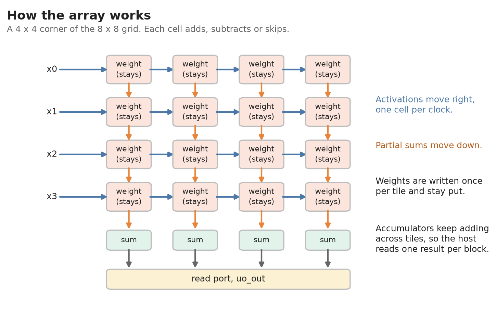

# Trit-TPU: 8x8 ternary systolic array

A Tiny Tapeout chip (GF180, 2x2 Tiny Tapeout tiles, 66.5 MHz) that multiplies matrices for ternary neural networks.
It is an 8x8 grid of cells. Each cell holds one weight (-1, 0 or +1), and the data flows through the grid.
Activations are 1 to 4 ternary digits. An optional double-data-rate input takes two commands per clock. It is off after reset, and a WRST command switches it on.



* Pins, commands, timing rules and speed: [docs/info.md](docs/info.md)
* Design: [src/project.v](src/project.v)
* Pin map and tile size: [info.yaml](info.yaml)

Clocks per 8x8 tile of weights for a 64x192 product (64 outputs, 192 inputs, readout included), and the estimated speed for a 3.4 million parameter model:

| digits per activation | 1 | 2 | 3 | 4 |
|---|---|---|---|---|
| Clocks per tile, single data rate | 9.036 | 10.036 | 11.036 | 12.036 |
| Clocks per tile, double data rate | 5.042 | 6.203 | 6.870 | 8.078 |
| Tokens per second, single data rate (estimate) | 139 | 125 | 113 | 104 |
| Tokens per second, double data rate (estimate) | 248 | 202 | 182 | 155 |

The token rates assume a host that can feed the pins at that speed, and they count only the matrix multiplications.

## Tests

```sh
pip install -r test/requirements.txt
cd test
make              # RTL simulation (TTPU_QUICK=1 make for a shorter run)
make GATES=yes    # gate level, needs PDK_ROOT and the netlist built by the GitHub workflow
```

## Status

Checked locally:
* Timing is met at a 15 ns clock: setup slack +0.41 ns, hold slack +0.12 ns.
* No layout rule violations. The Tiny Tapeout precheck passes (12 of 12).
* All 41 tests pass on the RTL and on the final gate-level netlist.
* These results are for `src/project.v` (sha256 starting `37ba4342`) and `src/config.json` (starting `c0ab3ee6`).

Not done yet:
* The GitHub workflow has not run.
* Nothing has run on silicon.
* Pad and board timing at 66.5 MHz is not checked.

Flow setting: the flow runs with `MAX_FANOUT_CONSTRAINT` 24 instead of its default 10 (see `src/config.json`). An earlier version of the design did not close timing at 10, and this build was not run at 10.

The output pins only change when you ask for a read (see [docs/info.md](docs/info.md)).
