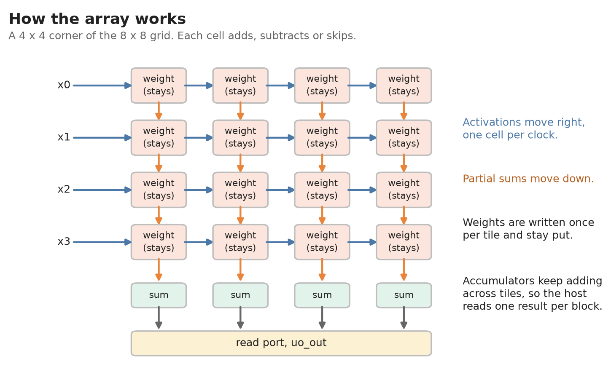
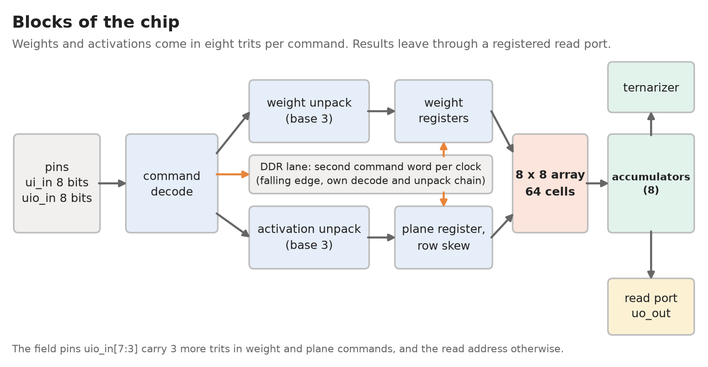
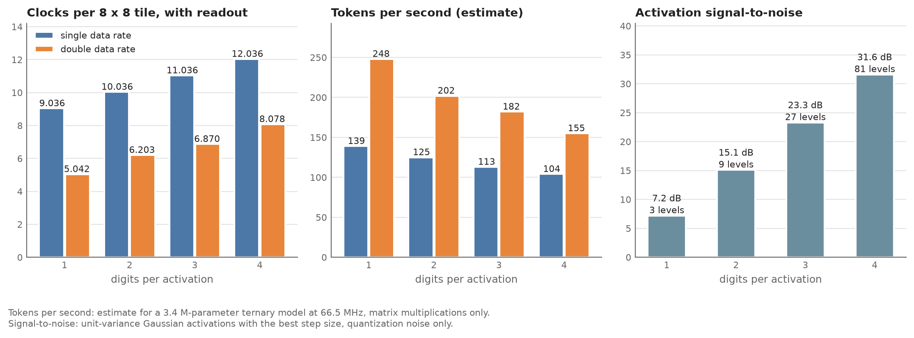

## How it works

Trit-TPU multiplies a matrix of ternary weights (-1, 0 or +1) by a vector. It is an 8 x 8 grid of cells. Each cell holds one weight and either adds, subtracts or skips, so the array has no multipliers. The weights stay in their cells while the activations flow through, so loading a tile of weights is a separate step from computing with it.



Activations are ternary digits. One digit has three levels (-1, 0, +1). A vector can use up to four digits, which gives 3, 9, 27 or 81 levels. The host picks the number of digits for each vector by sending that many digit planes. There is no mode register. One digit is called fast mode and two to four digits are called effort mode. In SDR mode every extra digit costs one more clock per tile. In DDR mode it costs less (see Speed).

Eight 16-bit accumulators sit under the columns. They scale each digit by 3^d (d = 0 for the least significant digit) with small lookup tables, add the digits together and keep adding across tiles. The host reads one result per output block instead of one per tile.

Weight and plane commands carry eight trits each. The data byte holds five trits packed in base 3 and the field on `uio_in[7:3]` holds three more. That is 13 pin bits for eight trits. A tile of weights takes 8 commands. A digit plane takes 1.

The CFG command sets a threshold `tau` for the ternary read-out. A column reads +1 if its sum is above `tau`, -1 if it is below `-tau`, and 0 otherwise.

The same design builds as a 4 x 4 array (`N = 4`, where a tile is 2 commands). The protocol and the tests handle both sizes. This submission is the 8 x 8 build.



### Pins

| pin | function |
|-----------|-----------------------------------------------------------------|
| `ui_in[7:0]` | Data byte: 5 trits of a weight group or digit plane, the threshold, or a stream length. |
| `uio_in[2:0]` | Command (table below). |
| `uio_in[7:3]` | Field. In W8 and plane commands it holds 3 more trits (`f = t5 + 3 t6 + 9 t7`, at most 26). In every other clock it is the read address, and the byte appears on `uo_out` 4 clocks later. |
| `uo_out[7:0]` | Registered read data. It changes only in a clock that carries a read address, and in every clock of a read stream. In a W8 or plane clock outside a stream the field pins carry data, so `uo_out` keeps the byte of the clock before. The host can ignore it then, and the pads do not toggle with the weight and plane traffic. It has no reset, so it is undefined until the first read data arrives. |
| `uio_out`, `uio_oe` | Unused. All bidirectional pins are inputs. |
| `clk`, `rst_n` | Clock from the board, and reset, which must be low for at least 3 clocks. |

### Commands

The command is on `uio_in[2:0]` and its data is on `ui_in` and the field.

| code | name | data | effect |
|----|------|------------------------------|--------------------------------------------------|
| 0 | NOP | none | Nothing. |
| 1 | W8 | 5 trits in `ui_in`, 3 in the field | Write the next weight group of 8 cells (see Weight order). The pointer wraps after 8 commands. An illegal byte or field writes zeros for that part and sets ERR. |
| 2 | WRST | none, or `0xD3` / `0x5D` in `ui_in` | Set the weight pointer to group 0 and clear ERR. With data `0xD3` or `0x5D` it also switches DDR mode on or off (see DDR mode). |
| 3 | CFG | `tau` (0 to 255) in `ui_in` | Set the threshold for the ternary read-out. |
| 4 | XP | like W8: the 8 rows of one digit plane | Next digit plane of the current vector. |
| 5 | XPF | like XP | First plane of a new vector. The sums add to the existing ones. |
| 6 | XPS | like XP | First plane of a new vector. The accumulators are cleared first, so use it at the start of an output block. |
| 7 | RDS | stream length `n` in `ui_in[5:0]`, start address in the field | Read stream. The address in the field is read as usual, then `n` more reads follow at the next addresses, one per clock. The address pins are ignored meanwhile, so W8 and plane commands can go on. |

Each trit is sent as a base-3 digit: 0 means 0, 1 means +1 and 2 means -1. The data byte is `b = t0 + 3 t1 + 9 t2 + 27 t3 + 81 t4`, at most 242. The field is `f = t5 + 3 t6 + 9 t7`, at most 26.

A vector is D digit planes (D = 1 to 4), least significant first, one command each. Plane d is scaled by 3^d. A fifth plane would be scaled by 3^0 again.

### Weight order

Cell (r, c) multiplies the activation of input row r and adds into output column c. The tile is therefore `W[r][c]`, with the row as the input index and the column as the output index.

The 64 cells are numbered in the order they are written: first by `r + c` (the anti-diagonal), then by `r`.

```text
position(r, c) = (number of cells with a smaller r + c) + (r - r_min)
r_min          = max(0, r + c - 7)
```

W8 command number j carries positions 8j to 8j+7. Trit i of the command (trits 0 to 4 in the data byte, 5 to 7 in the field) belongs to position 8j + i. The first anti-diagonals come first, so the weights of the next tile can follow the previous wave without an idle clock. `pack_tile` in `test/ttpu_model.py` implements this order.

### DDR mode

After reset the chip is in single data rate (SDR) mode and works as described above. A WRST command whose data byte is `0xD3` switches on double data rate (DDR) mode. A WRST whose data byte is `0x5D` switches it off. A WRST with any other data only rewinds the pointer and clears ERR. A reset switches DDR mode off. The mode applies to the pairs from the second clock after the command.

In DDR mode every clock carries a pair of command words on the same 16 pins:

* Lane 1 is the ordinary word, sampled on the rising edge of `clk`.
* Lane 0 is the word on the pins at the falling edge between the previous rising edge and the one that samples lane 1. The chip decodes it one clock later than lane 1, so a lane-0 command before rising edge `t` acts like a lane-1 command in clock `t + 1`. The model and the tests count lane-0 commands by this effective clock.
* Lane 0 understands W8, XP, XPF and XPS only. Other command words on lane 0 are ignored, whatever their data. CFG, WRST, RDS and the read addresses are lane 1 only.
* Weights: lane 0 writes groups 0 to 3 and lane 1 writes groups 4 to 7 (N = 4: group 0 and group 1). Each lane has its own pointer and writes in order. WRST rewinds both. In SDR mode the W8 commands fill groups 0 to 7 in order.
* Planes may come on either lane, but at most one plane per pair. Two planes in one pair set ERR, and the lane-1 plane counts.
* Illegal packed values on lane 0 set ERR as they do on lane 1.
* STATUS bit 3 reads 1 while DDR mode is on, and the protocol version at address 5 is 3.
* Pin timing for the board: change lane 0 after the rising edge and lane 1 after the falling edge. A quarter period after the edge is the middle of the window the tests use. The window that the real chip, pads and board allow has not been measured. Find it by reading the ID byte back at different phases.

`plan_block` in `test/ttpu_model.py` places a tile in DDR mode (call `Prog.ddr_enable()` first). The N = 4 build gains nothing from DDR.

### Read map

The address has 5 bits.

| address | byte |
|---------|-----------------------------------------------------------|
| `0x00` | ID, `0x3E` |
| `0x01` | `{3'd4, N}`: maximum digits and array size |
| `0x02` | Accumulator width (16) |
| `0x03` | Status. Bit 0 is READY, bit 1 is reserved (0), bit 2 is ERR, bit 3 is DDR mode on. |
| `0x04` | `tau` |
| `0x05` | Protocol version: 3 for the build with the DDR lane (the default), 2 without it |
| `0x08 + g` | Ternary byte g: columns 4g to 4g+3, with column 4g+j in bits `[2j+1:2j]` (code 00 is 0, 01 is +1, 11 is -1) |
| `0x10 + c` | Raw accumulator of column c, low byte (16-bit two's complement) |
| `0x18 + c` | Raw accumulator of column c, high byte |

All other addresses (`0x06`, `0x07` and `0x0A` to `0x0F`) read 0.

Let t0 be the clock in which the last plane command is on the pins. In DDR mode a plane on lane 0 counts at its effective clock.

* The ternary bytes and READY are valid when the read address is on the pins at t0 + 43 or later. The wait is the carries passing the four accumulator segments, then the scan of the ternarizer.
* The raw bytes settle earlier, column by column. The high byte of column c is valid when its address is on the pins at t0 + 19 + c, and the low byte 2 clocks earlier. A read stream over all 16 raw bytes may therefore start at t0 + 17.

These are the values of the default build. The optional `RPIPE = 1` build adds one clock to each. The bounds are tight, and the tests check them at the bound and one clock inside it.

### Timing rules for the host

These are for N = 8. The tests check each one at the bound and one clock inside it.

| rule | value |
|------------------------|--------------------------------------------------|
| Tile period in steady state, SDR mode (8 W8 commands and D plane commands, interleaved by the scheduler of `test/ttpu_model.py`) | 8 + D clocks: 9, 10, 11, 12 for D = 1 to 4 |
| Tile period in steady state, DDR mode (two commands per clock, at most one plane) | 4.75, 6, 6.67, 7 clocks for D = 1 to 4 (`plan_block`). The lower bound from the command slots is 4.5, 5, 5.5, 6. |
| DDR mode on or off | WRST with data `0xD3` or `0x5D`. Lane-0 words count from the second clock after it, so send NOPs or lane-1 commands meanwhile. |
| W8 command of group j, relative to the last plane of the previous tile (clock `X`) | Not before `X + 1 + rcmax(j)`, so the previous wave has left the group. |
| W8 command of group j, relative to the first plane of its own tile (clock `Y`) | Not after `Y + rcmin(j)`, so the weights are there when the wave arrives. |
| First plane (XPS) of the next block, in clock `tXPS` | Every raw byte of column c of the previous block must have its address on the pins no later than `tXPS + 15 + c` (`tXPS + 16 + c` with `RPIPE = 1`). For one read stream of 16 bytes from address `0x10` that starts at `t_raw`, this means `tXPS` not before `t_raw - 7` (`t_raw - 8` with `RPIPE = 1`). |
| A read in a clock with a W8 or plane command on the pins | Not possible, because the field pins carry data. Use RDS. |
| A new `tau` (CFG) | The ternary bytes follow `tau` continuously and READY does not drop. A ternary read whose address is on the pins 10 or more clocks after the CFG shows the new `tau` (5 to 10 clocks, depending on the phase of the ternarizer scan, measured on the RTL). Do not send the CFG before the address of a ternary read that still needs the old `tau`. |
| Reset | At least 3 clocks low, with `rst_n` synchronous to `clk`. A command in the first clock with `rst_n` high is accepted. |
| Input hold | Change `ui_in` and `uio_in` no earlier than about 3 ns after the clock edge at the pins. The flow closes hold against a 3 ns minimum external delay. A re-analysis of the netlist suggests that about 0.7 ns would also work, but that is an estimate and not part of the sign-off. This is an absolute time, so a slower clock does not relax it. |

`rcmin(j)` and `rcmax(j)` are the smallest and largest `r + c` among the 8 cells of weight group j. `plan_gemv` in `test/ttpu_model.py` is the reference scheduler. It produces the verified pin sequence for a matrix-vector product, one command word per clock.

### Speed

A tile needs 8 weight commands, and the array computes 64 products from them, so the pins set the speed. DDR mode gives 1.5 to 1.8 times the tokens per second of SDR mode.

| digits per activation | 1 | 2 | 3 | 4 |
|---------------------------------|-----|------|------|------|
| Clocks per tile, SDR, steady state | 9 | 10 | 11 | 12 |
| Clocks per tile, DDR, steady state | 4.75 | 6.0 | 6.67 | 7.0 |
| Clocks per tile, SDR, 64 x 192 product with readout gaps | 9.036 | 10.036 | 11.036 | 12.036 |
| Clocks per tile, DDR, 64 x 192 product with readout gaps | 5.042 | 6.203 | 6.870 | 8.078 |
| Tokens per second, SDR (estimate) | 139 | 125 | 113 | 104 |
| Tokens per second, DDR (estimate) | 248 | 202 | 182 | 155 |



A 64 x 192 product has 64 outputs and 192 inputs. That is 192 tiles in 8 output blocks of 24 tiles. In SDR mode the product takes 7 clocks more than 192 tiles at the steady-state period, which is 1 clock between output blocks. In DDR mode it takes 56, 39, 39 and 207 clocks more for 1 to 4 digits. These figures come from the reference scheduler (`plan_gemv`), and a better schedule might do better at four digits.

The token rates use the clocks per tile with readout gaps. They assume a 3.4 million parameter ternary model (53,125 tiles per token), 66.5 MHz, and a host that supplies one 16-bit pin word per clock in SDR mode or two in DDR mode. They count only the matrix multiplications. Norms, softmax, the KV cache and sampling are the host's work and are not included.

Each extra digit adds about 8 dB of signal-to-noise for one more clock per tile (9 to 11 percent more pin time in SDR mode). The figures are for unit-variance Gaussian activations with the best quantizer step and count quantization noise only. Whether a trained model works with one to four digits was not tested, because no model was trained for this project.

## How to test

1. Reset for 3 or more clocks, then read address 0. The value `0x3E` means the interface works. Address 1 returns `0x88` for the 8 x 8 build. Address 5 returns `0x03` for this build (`0x02` for the build without the DDR lane).
2. Load a tile: WRST, then 8 W8 commands. `pack_tile` in `test/ttpu_model.py` produces the command words.
3. Stream a vector: XPS with digit plane 0, then XP for the later planes.
4. Read the result at the clock given above. Either start a read stream (RDS, address `0x10`, length 15) and collect the 16 raw bytes, or poll address 3 until bit 0 is set and read the ternary bytes.
5. For a whole matrix-vector product, play the sequence from `plan_gemv` and compare the bytes read with the model.

Start with a slow clock of 20 to 30 MHz and raise it. The cocotb tests in `test/` check the protocol and the timing rules against the reference model `test/ttpu_model.py`. Their status is in the last section.

## External hardware

The chip needs a microcontroller or FPGA on the carrier board that:

* supplies the clock. The target is 66.5 MHz. The flow closes timing at 15 ns, but the pad and board timing at 66.5 MHz has not been verified.
* in DDR mode, drives the 16 pins with two words per clock, which is 133 million words per second at 66.5 MHz or about 200 to 250 MB/s, with an adjustable phase against the clock. That takes an FPGA with double-data-rate output cells, not a microcontroller. The Tiny Tapeout documentation rates the input pads at 66 MHz and the output pads at 33 MHz. Those are sky130 figures, and no GF180 figure was found. The documentation does not say whether the rating is a toggle rate or a square wave. A 133 Mbit/s bit toggles at 66.5 MHz. `uo_out` moves only for reads that were asked for, about one clock in ten of a 64 x 192 product. Inside a read stream it can change in every clock, which is a 33.25 MHz square wave at worst.
* drives `ui_in` and `uio_in` (16 bits per clock; no microcontroller peripheral was checked against this rate) and reads `uo_out`. In SDR mode the weights alone are 13 bytes per 9 clocks, about 96 MB/s at 66.5 MHz. A quad-SPI flash cannot supply that, so the model has to be in RAM. A 3.4 million parameter ternary model is 0.7 MB packed.
* does the work that needs high precision: norms, residuals, softmax, the KV cache and sampling.

## Status and limits

| | |
|------------------|----------------------------------------------------|
| Floor plan | 2 x 2 Tiny Tapeout tiles |
| Clock in the flow | 15 ns (66.7 MHz). `info.yaml` states a 66.5 MHz target. |
| Setup slack | +0.41 ns at the worst corner (slow, 125 C, 3.0 V). No violations at any of the nine corners. |
| Hold slack | +0.12 ns at the worst corner (fast). |
| Size | 1,557 flip-flops. The cells fill 83.7 percent of the 223,686 square micrometre core. |
| Layout checks | 0 DRC, 0 LVS and 0 antenna violations. The Tiny Tapeout precheck passes 12 of 12 checks when run locally. |
| Power | The flow's estimate, which uses default switching activity, is about 64 mW at the 15 ns clock. An activity-based estimate on an earlier version of the design gave about 40 mW with the clock alone and about 88 mW for a 64 x 192 product. Nothing was measured. |
| Tests | 41 cocotb tests pass on the RTL and on the gate-level netlist of the final layout. |
| Files these numbers are for | `src/project.v` (sha256 starting `37ba4342`) and `src/config.json` (sha256 starting `c0ab3ee6`). A change to either file needs a new run of the flow. |

What is not done or not known:

* There is no silicon, and nothing was measured on a board. Every number here comes from simulation or static timing analysis.
* Pad and board timing at 66.5 MHz is not verified, in SDR or in DDR mode. Output pad timing against a read stream that changes `uo_out` in every clock is not verified either.
* The flow setting `MAX_FANOUT_CONSTRAINT` is 24 in `src/config.json`, where the default is 10. An earlier version of this design (without the DDR lane) did not close timing at 10, and this build was not run at 10. The first run of the official flow is the check that it accepts the setting.
* The flow reports 496 maximum-slew warnings at the slow corner (none at the typical or fast corner) and 9 maximum-capacitance warnings on clock nets. Timing still closes at all corners, but the slow-corner slack is less certain than its sign suggests.
* The local precheck used KLayout 0.30.7. The Tiny Tapeout workflow uses 0.30.8 or later, and it has not run on this repository.
* Mutation testing and single-gate fault injection were run on earlier versions of the design with tools that are not in this repository. They were not repeated for this build. The activity-based power estimate was also made on an earlier version only.
* The accumulator wraps around. The sum of the products must stay below 32,768 in size, which allows K up to 32,767 for one digit, 8,191 for two, 2,520 for three and 819 for four. Longer sums have to be split into several output blocks and added by the host.
* The datapath has no reset. Weights must be written before use, and the first vector of an output block must be an XPS. `rst_n` is sampled directly, so it must be synchronous to `clk`. On the Tiny Tapeout board both come from the same microcontroller.
* The chip computes the integer products exactly, but nothing is claimed about the accuracy of any model.
